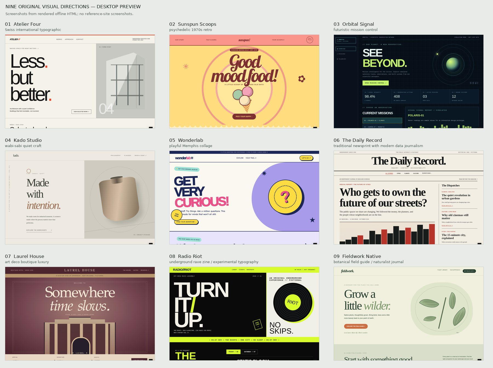

# Visual Design Intelligence

**A free, standalone AI-agent skill for generating original website and app designs.** Explore distinct visual directions, produce reusable design systems, build responsive clickable prototypes, and evaluate the results—all without a design subscription or a specific framework.

This is a **design skill, not an autonomous website builder**. It produces design concepts and prototype artifacts; deploying or modifying a production website is a separate, explicitly approved task.



*Actual prototype screenshots from nine fictional businesses: Swiss minimal architecture, retro ice cream, mission-control astronomy, quiet ceramics, playful children's museum, news editorial, art-deco hotel, rave poster, and botanical field guide.*

## What it does

- **Find a direction** — analyze a brief, audience, content, and optional design references; make purposeful visual decisions.
- **Explore alternatives** — create genuinely different layouts, typography, navigation, responsive strategies, and visual motifs, rather than recoloring one template.
- **Specify a system** — document colors, type, spacing, components, states, behavior, and design constraints in `DESIGN.md`.
- **Create clickable prototypes** — produce actual HTML/CSS/JS interfaces with realistic fictional content and functional demo interactions, when the agent has file-writing capability.
- **Verify visibly** — inspect responsive rendering and interactions when browser tooling is available; clearly identify checks that were not run.
- **Respect boundaries** — keep generated prototypes separate from live apps; do not copy protected third-party designs or publish without authorization.

## See nine different styles

| Fictional business | Visual direction | Try it |
| --- | --- | --- |
| Atelier Four — architecture | Swiss minimalist | [Interactive demo](examples/showcase/01-atelier-four.html) |
| Sunspun — ice cream | Psychedelic retro | [Interactive demo](examples/showcase/02-sunspun.html) |
| Orbital Signal — observatory | Futuristic mission control | [Interactive demo](examples/showcase/03-orbital-signal.html) |
| Kado Studio — ceramics | Quiet craft | [Interactive demo](examples/showcase/04-kado-studio.html) |
| Wonderlab — children's museum | Memphis collage | [Interactive demo](examples/showcase/05-wonderlab.html) |
| The Daily Record — journalism | Classic newspaper | [Interactive demo](examples/showcase/06-the-daily-record.html) |
| Laurel House — hotel | Art Deco | [Interactive demo](examples/showcase/07-laurel-house.html) |
| Radio Riot — music festival | Underground zine | [Interactive demo](examples/showcase/08-radio-riot.html) |
| Fieldwork Native — plant nursery | Botanical field guide | [Interactive demo](examples/showcase/09-fieldwork-native.html) |

[View the comparison gallery](examples/showcase/00-start-here.html) · [Phone screenshots](examples/images/nine-phone-comparison.jpg)

These are offline prototypes with made-up businesses. GitHub does not execute HTML pages inside its file viewer: download the repository and open the `.html` files locally in a browser to interact with them. Their presence illustrates the range of achievable results, not a guarantee that every agent or every prompt will reach the same quality.

## Quick start

1. Download this repository as a ZIP, or clone it.
2. Give the entire skill directory to an AI coding/design agent that supports `SKILL.md`, including the `data`, `references`, `assets`, and `scripts` folders.
3. Ask the agent to read `SKILL.md` and create a design artifact. It can run without an account, paid API, external assets, or a preexisting app repository. Prototypes require a runtime able to write files; rendered screenshots require browser tooling.

**Copy-paste starting request:**

```text
Use the Visual Design Intelligence skill in this directory.
Create three substantially different, original visual directions for a fictional independent bike-repair shop.
All concepts must contain the same services, opening hours, service-request form, and contact information.
Build three self-contained responsive HTML prototypes with realistic fictional data and functional demo interactions.
Make layout architecture, typography, navigation, and art direction different—not just colors.
Keep all files in a new isolated output directory. Do not modify an existing app or deploy anything.
Where browser tools exist, test desktop and mobile layouts and the primary interactions.
Report what passed, what failed, what was not tested, and any reference or asset permissions.
Stop after delivering the prototypes and a concise comparison.
```

### Install in a project (Codex / Claude Code)

Copy the **whole skill folder** to a supported skill discovery directory, keeping `SKILL.md` at the top of that folder.

| Agent | Example project-local destination |
| --- | --- |
| Codex | `.agents/skills/visual-design-intelligence/SKILL.md` |
| Claude Code | `.claude/skills/visual-design-intelligence/SKILL.md` |
| Other skill-enabled agents | Their documented `SKILL.md` directory location |

Discovery rules can change; consult your agent's documentation. You may also open this repository as a standalone project and instruct a coding agent to read its `SKILL.md` directly—installation isn't required just to evaluate it.

## What's included

```text
SKILL.md                         # Agent instructions and safety boundaries
README.md                        # This guide
LICENSE                          # MIT license
CONTRIBUTING.md                  # Contribution guidelines
data/style-recipes.json           # 16 editable, original visual style recipes
scripts/style_catalog.py         # Offline style lookup (Python stdlib)
scripts/validate_package.py      # Package smoke checks
references/                      # Source research, patterns, QA, goal prompt
assets/                           # Design brief, design system, prototype starter
examples/                         # Test cases, preview screenshots, nine demos
```

### Explore the offline style catalog

Requires Python 3, with **no dependencies**:

```bash
python scripts/style_catalog.py list
python scripts/style_catalog.py search --query 'editorial mobile'
python scripts/style_catalog.py show --id editorial-warmth
python scripts/style_catalog.py validate
python scripts/validate_package.py
```

On Windows PowerShell, start by entering the repository directory:

```powershell
Set-Location "C:\path\to\visual-design-intelligence"
python .\scripts\style_catalog.py list
python .\scripts\validate_package.py
```

## How it works

1. **Intake** — interpret the brief, key user journeys, platform constraints, and desired deliverable.
2. **Research** — identify suitable visual patterns using public, rights-respected references or the offline recipes.
3. **Creative directions** — articulate distinct design theses and layouts; explain strengths and tradeoffs.
4. **Artifact production** — build design systems, responsive interactive prototypes, or implementation handoffs.
5. **Evidence-based QA** — evaluate actual rendered behavior where possible, document gaps, and stop at the requested boundary.

The skill supports `INSPIRE`, `DIRECTIONS`, `SYSTEM`, `PROTOTYPE`, `REVIEW`, and `HANDOFF` modes. It is **provider-neutral** and does not rely on Kombai, Figma, Mobbin, Refero, or a paid subscription.

## Limitations and safeguards

- The bundled catalog has **16 original style recipes**, not a collection of thousands of third-party templates.
- Links to reference websites are research starting points; their images, layouts, CSS, and licenses are **not** bundled or granted for reuse.
- Demo forms and interactions are fictional/local. Prototypes are **not** production-ready apps, payment systems, booking engines, or live websites.
- Visual quality and accessibility depend on the executing agent and available browser tools. Automated checks are not equivalent to formal WCAG certification or human design review.
- The agent must distinguish observed facts from assumptions and must not invent real business facts for published client sites.
- This skill does **not** authorize writing to existing repositories, publishing, or deploying without separate approval.

## Inspirations and attribution

The approach is informed by public discussions and documentation from [Kombai](https://kombai.com/), [UI/UX Pro Max](https://github.com/nextlevelbuilder/ui-ux-pro-max-skill), [Anthropic's public frontend design guidance](https://github.com/anthropics/skills), [Refero Styles](https://styles.refero.design/), [Component Gallery](https://component.gallery/), and the [W3C WCAG 2.2 Quick Reference](https://www.w3.org/WAI/WCAG22/quickref/). This package is an original implementation; it does not include proprietary website designs or those projects' source material.

## License

MIT — see [LICENSE](LICENSE). Contributions welcome; see [CONTRIBUTING.md](CONTRIBUTING.md).
